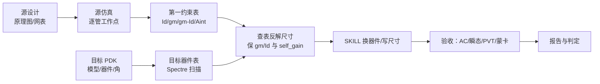

# amigrate — 模拟电路迁移工具链

把已验证的模拟电路从**源 PDK** 迁移到**目标 PDK**，并用仿真证明迁移后仍满足指标：
**参数提取 → 尺寸反解 → 原理图修改 → 仿真验收 → 报告**。

> 当前案例：SMIC 180nm `smic18ee` 的 OPA_D → SMIC 130nm `PDK_13mmrf_1P6M_30k`（1.8 V，n33/p33 IO 器件）。
> 研究与教学用途，**非商业**；仓库**不含**任何 PDK 模型/规则文件（NDA 约束，运行需自备授权 PDK）。

## 当前进展（2026-11-27）

| 能力 | 状态 | 证据 |
|---|---|---|
| 器件特性表（LUT） | ✅ 13mmrf 101,080 行（5 mV 网格，含 Avt/β/噪声） | `runs/2026-11-25-lut-build/` |
| 尺寸反解（gm/Id + self_gain + 3σ） | ✅ OPA_D 8/8 | `tools/solve_lw.py`、`runs/2026-11-25-io18-ac/` |
| SKILL 自动换器件/写尺寸 | ✅ 真实原理图 8/8 | `skill/`、`runs/2026-11-25-pdk-probe/` |
| 标称验收 | ✅ 6/6（82.4 dB / 31.6 MHz / 70.9° / SR± / 608 µW） | `runs/2026-11-25-io18-ac/target-result.json` |
| PVT 45 角 | ✅ 45/45（最坏 UGF 10.97 MHz） | `runs/2026-11-25-pvt/` |
| 蒙卡 300 点 | ✅ 100% 良率（Vt 失配） | `runs/2026-11-26-mc/` |
| 噪声 / CMRR / PSRR 角集 | ✅ 已跑（见报告） | `runs/2026-11-26-noise/`、`runs/2026-11-26-cpo/` |
| **通用化（任意 PDK）** | ✅ 原型：发现→建表→约束→反解→SKILL 脚本，8/8 | `docs/porting/generic-migration.md` |
| 网页向导 / 桌面软件 | ✅ 无控制台窗口、PVT 一键输出 | `tools/webui.py`、`tools/amigrate_app.py` |

## 架构



## 快速开始

```bash
# 查看工程状态
python tools/amigrate.py status

# 反解尺寸 / 生成 PVT 网表 / 判卷 / 报告
python tools/amigrate.py solve
python tools/amigrate.py pvt        # 生成后按提示在 VM 跑 Spectre
python tools/amigrate.py judge
python tools/amigrate.py report

# 网页向导（本地，无第三方依赖）
python tools/webui.py               # → http://127.0.0.1:8800
```

环境要求：Windows + Python 3.12；VMware 虚拟机（IC618）内装 Virtuoso、Spectre 18.1、已授权 PDK；`ssh ic618` 免密可达。

## 目录结构

```
tools/      采集/反解/求解/仿真/报告/网页与桌面程序（含通用化流程）
skill/      SKILL 脚本：换器件、写尺寸、导出网表
specs/      迁移规格与表结构（TOML）
docs/       决策、方法、报告、交接与汇报文档
runs/       每次实验的证据（大文件与原始数据不入库）
assets/     图标等静态资源
```

## 文档导航

- **给老师/评审的汇报**：[docs/教师汇报说明-2026-11-27.md](docs/教师汇报说明-2026-11-27.md)
- 迁移方法与表结构：[docs/porting/lut-to-schematic-pipeline.md](docs/porting/lut-to-schematic-pipeline.md)
- 通用化流程与已知问题：[docs/porting/generic-migration.md](docs/porting/generic-migration.md)
- 验证报告（标称/PVT/蒙卡）：[docs/reports/verification-2026-11-26.md](docs/reports/verification-2026-11-26.md)
- 现状与改进项：[docs/reports/status-2026-11-26.md](docs/reports/status-2026-11-26.md)
- 交接文档（环境/命令/坑）：[docs/交接文档-2026-11-26.md](docs/交接文档-2026-11-26.md)
- 开源合规说明：[NOTICE.md](NOTICE.md)

## 边界与声明

- 不做版图迁移 / PEX 后仿；迁移配对为本例的 180nm→130nm 跨节点；
- 不含 PDK 模型、器件库、DRC/LVS 规则（NDA）；
- 参考了公开专利 CN116964587A 的方法思路（仅引用，未复制文本/图表/代码），与华为无隶属或背书关系；
- 商用前请自行完成专利 FTO 与 PDK 合规审查。