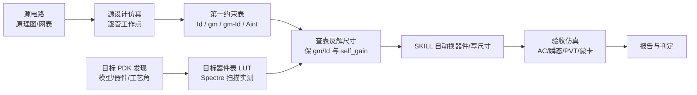

# 模拟电路迁移工具链：进展汇报（2026-11-27）

> 给老师看的 1–2 页说明。仓库：https://github.com/Wang-ZH-study/amigrate

## 一、要解决的问题

把一个已经在某个工艺上验证过的模拟电路，迁移到另一个工艺/PDK 上，并且**用仿真证明迁移后仍然满足指标**。传统做法靠工程师手工改尺寸、反复试；本项目把"参数提取 → 尺寸反解 → 原理图修改 → 仿真验收"做成可复现的工具链。

当前案例：SMIC 180nm（smic18ee）的 OPA_D 运算放大器 → SMIC 130nm（PDK_13mmrf，1.8V 供电，用 3.3V IO 器件）。

## 二、方法：以"器件表 + 约束"为核心的迁移流程

核心思想：**不直接迁移尺寸，而是迁移"工作点"**——让目标工艺的器件在相同 gm/Id、相同本征增益下工作，再反推 W/L。

## 三、已经完成的工作

| 模块 | 内容 | 状态 |
|---|---|---|
| 器件表 | 源/目标 PDK 的器件特性表（Id/gm/gds/self_gain/电容/失配），13mmrf 表 101,080 行 | ✅ |
| 尺寸反解 | gm/Id + self_gain 双重匹配，带 3σ 失配容忍带；可行性判据 F0–F4 | ✅ |
| 原理图操作 | SKILL 自动复制、换器件、写尺寸（真实 OPA_D 上 8/8 成功） | ✅ |
| 验收 | 标称 6/6 达标；PVT 45/45 通过；蒙卡 300/300 良率 100% | ✅ |
| 参数口径 | 与华为 CN116964587A 的参数提取对照，9 组参数 8 组覆盖 | ✅ |
| 通用化 | 任意 PDK：发现 → 建表 → 源约束 → 反解 → 生成 SKILL 脚本（13mmrf 上 8/8） | ✅ 原型 |
| 工具形态 | 网页向导 + 桌面软件（无控制台窗口）、PVT 一键输出、实时进度 | ✅ |

**关键数字**（OPA_D → 13mmrf，1.8V）：增益 82.4 dB、单位增益频率 31.6 MHz、相位裕度 70.9°、压摆率 +21/−71 V/µs、功耗 608 µW；最坏工艺角 UGF 10.97 MHz（仍达标）。

## 四、目前的主要不足

1. **通用建表慢**：带失配统计块的器件单次扫描约 3 分钟/切片，完整网格到小时级——这是通用化能否实用的关键卡点；
2. **蒙卡口径有限**：完整统计蒙卡是按 PDK 四项失配参数等价注入，未直接调用 PDK 统计块；
3. **SKILL 未全自动**：通用流程目前生成转换脚本，最后一步仍需在 Virtuoso 里执行；
4. **版图/PEX 不在范围**：只做原理图级迁移与仿真验收。

## 五、下一步计划

1. 优化建表速度（换器件模型用法/降网格/并行）；
2. 把 SKILL 执行接进网页流程，做到"一键迁移 + 自动验收"；
3. 用第二个电路（吉尔伯特乘法器）验证流程复用成本；
4. 补 CMRR/offset/PSRR 的角集与正式验证报告。

## 六、怎么查看/试用

- 浏览器看代码与文档：仓库地址；
- 本机运行：`python tools/amigrate.py status`（需 VMware 虚拟机 + Virtuoso + Spectre）；
- 网页界面：`python tools/webui.py` → http://127.0.0.1:8800（桌面双击图标亦可）。

> 说明：本项目仅用于研究与教学，非商业用途；不含任何 PDK 模型/规则文件（受 NDA 约束），运行需自备已授权的 PDK 环境。